<div align="center">


# Multi OBS

Plusieurs **OBS Studio** indépendants, pilotés depuis une seule fenêtre : ta caméra, ton écran et ton live enregistrés séparément, sans que les OBS se marchent dessus.

[**⬇ Télécharger pour Windows**](https://github.com/StundZow/multi-obs/releases/latest/download/Multi-OBS-Setup.exe) · [Releases](https://github.com/StundZow/multi-obs/releases)

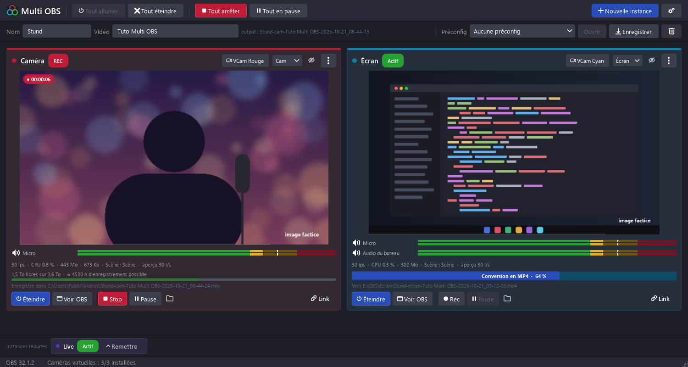

<sub>Les aperçus de ces captures sont des images factices.</sub>

</div>

## Ce que ça fait

Pour enregistrer ta caméra et ton écran dans des fichiers séparés — et parfois faire un live en même temps — il faut plusieurs OBS. Multi OBS lance autant d'**instances** que tu veux : chacune est un vrai OBS, avec ses scènes, ses réglages, sa couleur et sa caméra virtuelle, et tu les pilotes toutes depuis une seule fenêtre — aperçu en direct, son, enregistrement, pause.

Les fenêtres OBS restent réduites : tu ne les ouvres (**Voir OBS**) que pour régler tes scènes.

## Pourquoi pas juste ouvrir deux OBS ?

Parce que deux OBS lancés normalement partagent le même dossier de configuration : quand l'un enregistre un réglage, l'autre plante. Et Streamlabs, souvent utilisé comme « deuxième OBS », ne sait pas mettre un enregistrement en pause. Ici, chaque instance a sa propre installation portable : elles ne peuvent pas se gêner.

## Fonctionnalités

- 🧩 **Instances indépendantes** — scènes, profils, plugins et réglages séparés ; aucune ne peut faire planter les autres
- 🔗 **Pilotage global** — tout allumer, tout enregistrer, tout mettre en pause d'un clic ; une instance déliée (**Link**) reste à part, pratique pour le live
- ⏱️ **Départ, pause et arrêt à l'image près** — « Tout enregistrer » aligne le début des fichiers, « Tout en pause » enlève exactement les mêmes images partout, « Tout arrêter » les finit sur la même image : même nombre d'images dans chaque fichier, les pistes se calent d'un coup au montage
- 🚨 **Alertes immédiates** — rec bloqué, OBS fermé pendant le rec, erreur d'OBS, son qui décroche ou micro perdu, encodeur en panne, images perdues, disque presque plein : bandeau rouge, carte en rouge, bouton de la barre des tâches qui clignote, cadre rouge sur le Stream Deck
- 🎛️ **Plugin Stream Deck** — des touches colorées pour chaque OBS ou pour tout Multi OBS : rec avec le timecode, pause, allumer / éteindre, scènes, sources, filtres, son, live… en appui court ou long ; installé en un clic
- 👀 **Aperçu en direct sans compression**, vumètres audio, images perdues, CPU, et alertes (pas de son, disque presque plein, OBS qui attend une réponse)
- 🗂️ **Instances réduites** — le bouton **œil barré** range une instance dont tu ne te sers pas (l'OBS du live…) dans une barre en bas, avec son état ; **Remettre** la ramène parmi les autres
- 🎥 **Une caméra virtuelle par instance**, au nom de sa couleur — « VCam Rouge », « VCam Bleu »… pour Discord, Zoom ou une autre instance, sans droits administrateur
- 🏷️ **Nommage automatique** — `Nom-type-Vidéo-date_heure`, avec tes propres types (Cam, Écran et Live par défaut)
- 🎞️ **MKV → MP4 automatique** à la fin du rec, avec l'avancement de chaque conversion sur sa carte, et option pour mettre le MKV à la corbeille une fois le MP4 vérifié
- 💾 **Espace disque** et fichier en cours affichés sur chaque instance, dossier d'enregistrement en un clic
- 🎨 **Une couleur par instance** — thème OBS teinté, logo coloré dans la barre des tâches, image de caméra virtuelle assortie
- 📦 **Préconfigs** — enregistre et rouvre un ensemble complet d'instances
- 🔄 **Mise à jour automatique** intégrée, avec le changelog

<div align="center">
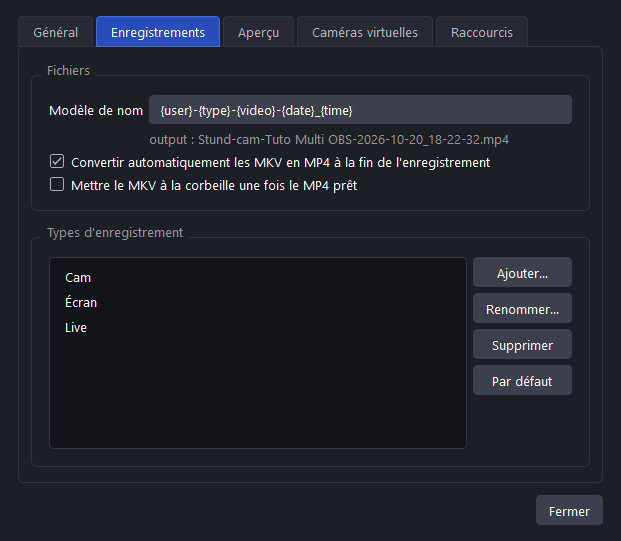
&nbsp;&nbsp;
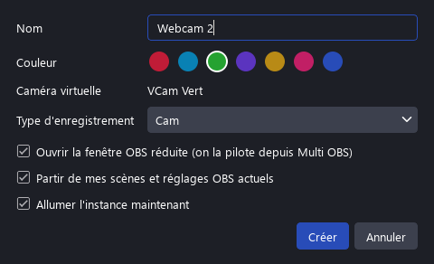
</div>

## Prise en main

1. [Télécharge `Multi-OBS-Setup.exe`](https://github.com/StundZow/multi-obs/releases/latest/download/Multi-OBS-Setup.exe) et lance-le — pas besoin d'être administrateur. [OBS Studio](https://obsproject.com/) doit être installé.
2. Trois cases à cocher (menu Démarrer, bureau, lancer à la fin) et un dossier d'installation modifiable.
3. **Nouvelle instance** : un nom, une couleur, un type. « Partir de mes scènes et réglages OBS actuels » copie ta config OBS — ton OBS habituel n'est pas modifié.
4. **Voir OBS** pour régler les scènes de l'instance, puis pilote tout depuis Multi OBS : **Rec**, **Pause**, **VCam**, et les boutons du haut pour toutes les instances liées. Avec **Tout enregistrer**, Multi OBS cale les fichiers à l'image près pendant la première seconde (une courte pause) : attends 1 à 2 secondes avant de parler.
5. Remplis **Nom** et **Vidéo** en haut : chaque fichier s'appellera par exemple `Stund-cam-Tuto-2026-10-20_17-49-50.mp4`.
6. Une instance ne sert pas aujourd'hui (l'OBS du live…) ? Le bouton **œil barré** de sa carte la range en bas, avec son état ; **Remettre** la ramène :

<div align="center">
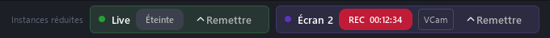
</div>

## Alertes

Si quelque chose cloche pendant un rec ou un live, Multi OBS le dit tout de suite, sans aucun bruit pour que rien ne s'entende dans tes recs : bandeau rouge en haut de la fenêtre, message en rouge sur la carte de l'instance, bouton de la barre des tâches qui clignote. **Masquer** cache le bandeau jusqu'au prochain problème.

<div align="center">
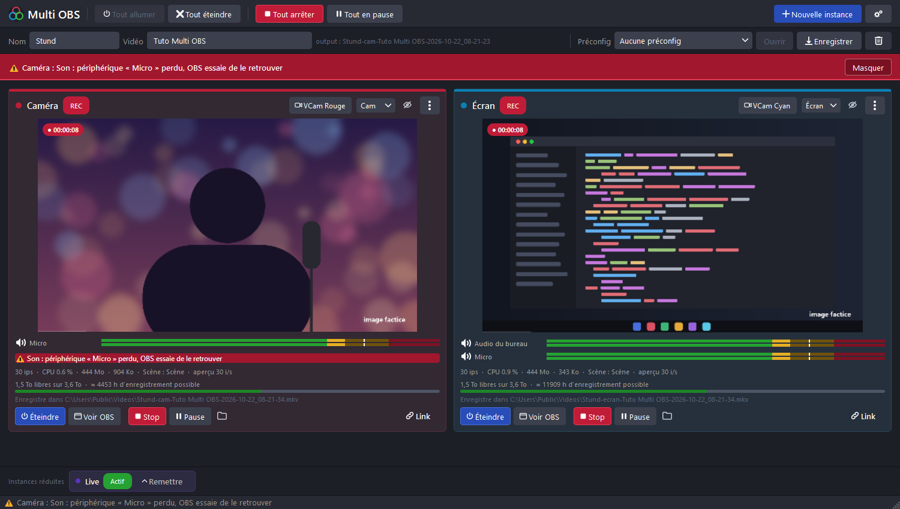
</div>

Ce qui est surveillé : rec bloqué (le fichier ne grossit plus), rec qui ne démarre pas, arrêt qui ne se termine pas, OBS fermé ou planté pendant le rec, fenêtre d'erreur d'OBS, son qui décroche ou micro perdu, webcam ou carte d'acquisition en erreur, encodeur en panne, écriture du fichier impossible, carte graphique perdue, images perdues en rafale ou sautées à l'encodage, disque presque plein, et une deuxième capture de jeu du même jeu (elle enregistrerait du noir).

Sur le Stream Deck, les touches de l'OBS concerné et les touches **TOUS** prennent un cadre rouge et affichent « ALERTE » une seconde sur deux :

<div align="center">
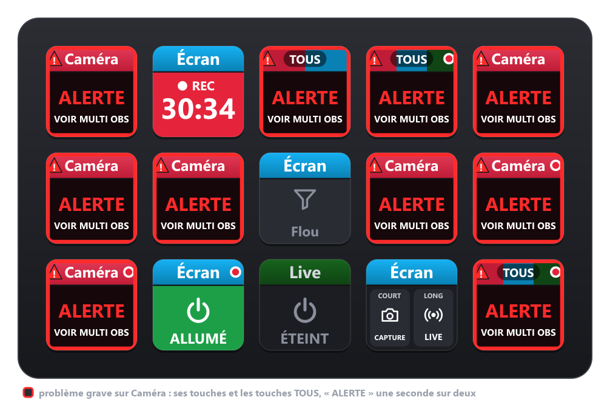
</div>

## Caméras virtuelles

Chaque instance a sa propre caméra virtuelle, au nom de sa couleur (« VCam Rouge », « VCam Bleu »…), à côté de « OBS Virtual Camera » de ton OBS habituel. Pour partager ta webcam entre plusieurs instances, l'instance qui la capture allume sa **VCam**, et les autres ajoutent une source « Périphérique de capture vidéo » sur cette caméra. Une instance ne voit pas sa propre caméra virtuelle, ce qui évite les boucles. Si une caméra disparaît de Windows, Multi OBS la remet tout seul.

Quand une caméra virtuelle est éteinte, son image d'attente prend la couleur de son instance :

<div align="center">
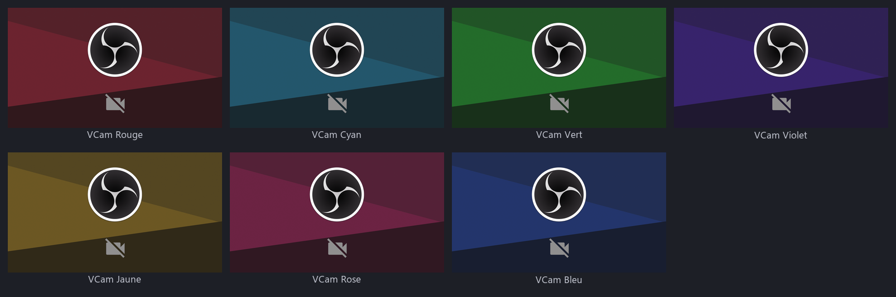
</div>

## Stream Deck

Multi OBS est livré avec son plugin Stream Deck. En bas à droite de la fenêtre, **Plugin Stream Deck : Installer** (ou ⚙ → **Stream Deck**) : le logiciel Stream Deck demande confirmation, puis la catégorie **Multi OBS** apparaît dans sa liste d'actions. Glisse les actions sur tes touches. Pas besoin du Marketplace. Ensuite, le même coin affiche « Stream Deck connecté », et propose de mettre le plugin à jour quand une nouvelle version de Multi OBS en apporte un.

<div align="center">
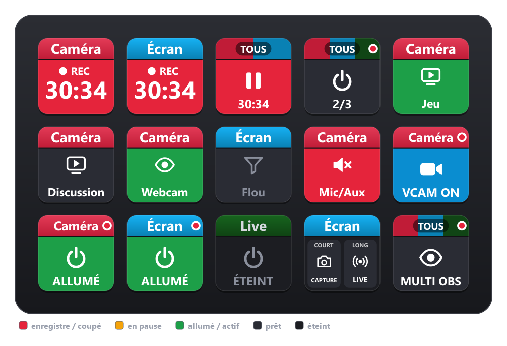
</div>

En haut de chaque touche, l'OBS qu'elle pilote : sa couleur et son nom, ou **TOUS** avec les couleurs des instances concernées (atténuées si elles sont éteintes). En dessous, son état, toujours dans les mêmes couleurs : **rouge** = enregistre (ou son coupé, live en cours), **orange** = en pause, **vert** = allumé ou actif, **gris** = éteint.

| Action | Ce qu'elle fait |
|---|---|
| **Enregistrer** | démarre / arrête le rec, avec le timecode sur la touche. Au choix : appui court = pause et appui long = rec / stop, pour ne jamais couper un rec par erreur |
| **Pause** | met en pause / reprend, à l'image près avec « Tous » |
| **Allumer / Éteindre** | allume ou éteint un OBS, ou toutes les instances ; refusé pendant un rec |
| **Action OBS** | changer de scène, montrer / cacher une source, activer / couper un filtre, couper le son, lancer le live, capture d'écran, rec, pause… et une 2e action en appui long si tu veux (la touche se partage alors en deux) |
| **Caméra virtuelle** | allume / éteint la VCam d'un OBS |
| **Voir OBS** | affiche la fenêtre de l'OBS, ou celle de Multi OBS avec « Tous » |

Pendant un appui long, un cercle blanc grandit jusqu'à couvrir la touche, et l'action part quand il la remplit. Les touches suivent OBS en direct : une scène passée à l'antenne, une source cachée ou un son coupé depuis OBS se voient aussi sur le Stream Deck.

« Tous » fait comme les boutons du haut de Multi OBS : allumer / éteindre toutes les instances, enregistrer et mettre en pause les instances liées (**Link**). Si Multi OBS est fermé, un appui sur une touche l'ouvre. En cas de problème grave, les touches passent en alerte (voir [Alertes](#alertes)).

<div align="center">
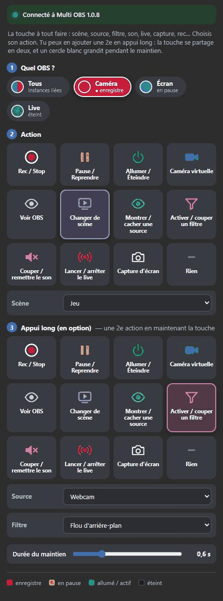
&nbsp;&nbsp;
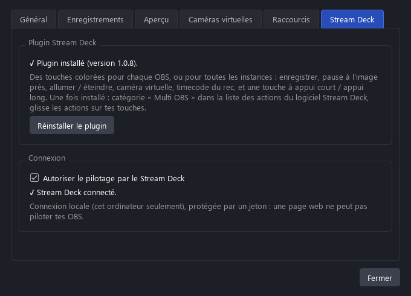
</div>

## Barre des tâches

Chaque instance porte un nom clair et le logo OBS à sa couleur, pour s'y retrouver d'un coup d'œil :

<div align="center">

</div>

## Aperçu économe

L'aperçu est **sans compression** (par défaut 60 images/s en 1/4) et coûte le moins possible :

- jamais plus de pixels que l'écran n'en affiche, ni plus d'images que la scène OBS n'en produit ;
- **en pause** quand il ne sert à rien : fenêtre réduite, carte hors de l'écran, aperçu masqué, session verrouillée, écran éteint ;
- image figée : ni décodage ni affichage ;
- si OBS perd des images, l'aperçu ralentit tout seul pour protéger l'enregistrement ;
- décodage dans un thread à part, de priorité basse.

Mesuré avec trois instances et les réglages par défaut : 2 à 4 % du processeur pour les trois OBS, autant pour Multi OBS, sans image perdue à l'enregistrement.

<div align="center">
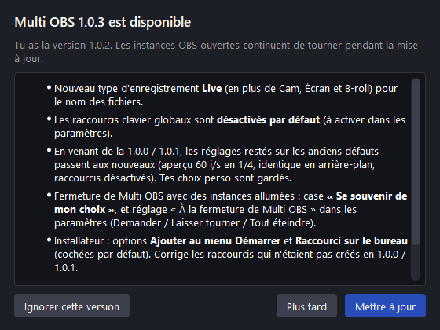
&nbsp;&nbsp;
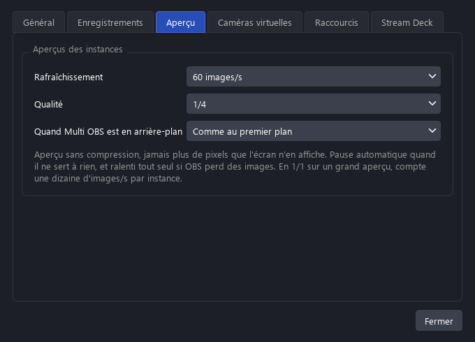
</div>

## Comment ça marche

- **Une installation OBS portable par instance.** Multi OBS copie ton OBS une fois (`data/runtime`), et chaque instance y pointe par liens physiques : trois instances ne prennent presque pas plus de place qu'une. Chacune a son propre dossier `config/`.
- **Pilotage par obs-websocket**, intégré à OBS : une connexion pour les commandes et l'état, une seconde en binaire (MessagePack) réservée à l'aperçu.
- **Pause à l'image près** : chaque OBS a sa propre horloge d'images et coupe une pause sur l'une d'elles ; mis en pause « en même temps », deux OBS peuvent enlever une image de plus ou de moins, et l'écart s'accumule (jusqu'à 6 images après 20 pauses dans nos mesures). Multi OBS exécute la pause et la reprise dans la boucle d'images de chaque OBS (lots obs-websocket « SerialFrame ») et programme chaque reprise exactement N images après la pause : **0 image d'écart sur 100 pauses mesurées** à 60 i/s, aperçus allumés ou non (mesure image par image sur les fichiers enregistrés). OBS ignore une pause demandée juste après une reprise (en répondant « OK ») : Multi OBS attend ce qu'il faut et redemande si besoin, sans casser l'égalité.
- **Départ et arrêt à l'image près** : obs-websocket ne dit pas à quelle image commence un fichier, et chaque OBS démarre son rec quand son interface le peut (0 à 7 images d'écart mesurées en banc, 16 lors d'un vrai rec). Multi OBS ajoute à chaque instance un petit module OBS open source ([`obsplugin/multiobs-sync.c`](obsplugin/multiobs-sync.c)) qui relève, pour chaque image écrite, son heure de rendu et sa position dans le fichier. Tout se fait pendant le rec, les fichiers ne sont jamais retouchés après : juste après le départ, toutes les instances font une courte pause sur la même image, celles parties en avance y restent plus longtemps (exactement leur nombre d'images d'avance), puis tout est revérifié ; à l'arrêt, chaque OBS coupe sur la même position. Seul effet visible : un petit saut (0,1 s, plus l'avance éventuelle) dans la première seconde de chaque fichier, son et image ensemble. Mesuré avec un flash (une image blanche envoyée à toutes les instances à la même image) : **65 départs et 65 arrêts alignés au mieux sur 65**, avec plusieurs réglages (il reste au plus une fraction d'image : les horloges d'images des OBS ne sont pas en phase). Chaque pause resynchronise aussi les fichiers. Les pauses d'alignement durent au moins 0,1 s : une pause de moins de 21 ms fait perdre le son à OBS pour de bon (bug d'OBS) et l'enregistrement ne peut plus s'arrêter.
- **Bridage de Windows 11 évité** : réduit ou en arrière-plan, un programme n'obtient plus la minuterie précise qu'il demande ; OBS rendait alors chaque image jusqu'à 15 ms après son heure (petites saccades). Multi OBS retire ce bridage pour ses OBS : moins de 2 ms.
- **Testé sous la charge d'un jeu** : un programme Direct3D 11 capturé en capture de jeu (carte graphique à 99-100 %, 6 Go de mémoire vidéo), des chargements (processeur à 100 %, 6 Go écrits sur le disque) et des pics, avec des pauses régulières, comparé à trois OBS lancés seuls. Aucun plantage, fichiers intacts, son calé sur l'image à quelques millisecondes près, mêmes nombres d'images dans les trois fichiers. Quand carte graphique et processeur saturent ensemble, des OBS seuls répètent 12 à 14 % des images (encodeur qui décroche) ; Multi OBS, qui met ses OBS en priorité « au-dessus de la normale » : 0 à 0,1 % (une fois 7 % pour l'instance 4K, la plus lourde, et l'alerte « images perdues » le signale).
- **Alertes** : en plus de l'état donné par obs-websocket (fichier qui ne grossit plus, OBS fermé, images perdues…), Multi OBS lit le journal de chaque OBS en direct : son qui décroche, périphérique perdu, encodeur en panne, écriture impossible, carte graphique perdue.
- **Stream Deck** : le plugin (Node.js fourni par le logiciel Stream Deck, sans dépendance) parle à Multi OBS par un petit serveur WebSocket local : 127.0.0.1 seulement, jeton renouvelé à chaque démarrage (dans `%LOCALAPPDATA%\Multi OBS\remote.json`), connexions venant d'une page web refusées. Multi OBS pousse l'état des instances, et suit dans OBS ce que les touches affichent (scène à l'antenne, filtres, sources visibles, sons coupés) grâce à ses événements ; le plugin dessine les touches en SVG.
- **Caméras virtuelles** : le module de caméra virtuelle d'OBS est dupliqué et modifié pour chaque instance (identifiant et mémoire partagée propres), puis enregistré pour l'utilisateur courant.
- **Installateur unique** : `Multi-OBS-Setup.exe` contient l'appli. Au lancement, il vérifie s'il existe une version plus récente sur GitHub. Les mises à jour de l'appli téléchargent ce même installateur, qui remplace Multi OBS et le relance — les instances OBS continuent de tourner pendant ce temps.
- **Testé** par une batterie de près de 60 vérifications : enregistrements simultanés avec pauses (durées, images, son), boutons, raccourcis, aperçus, économies, plantages, redémarrage ; par des bancs qui relisent chaque image des fichiers pour vérifier que départs, pauses et arrêts tombent sur les mêmes images partout ; par des pannes provoquées exprès (OBS tué en plein rec, rec bloqué, erreurs dans le journal d'OBS, encodeur débordé) pour vérifier chaque alerte ; par les tests de charge ci-dessus ; et par un test de bout en bout du Stream Deck (faux logiciel Stream Deck, vrai plugin, vrais OBS : 98 vérifications).

Les données sont dans le dossier d'installation :

```
Multi OBS.exe
data/
  runtime/      copie d'OBS
  instances/    une installation OBS portable par instance
  vcam/         modules des caméras virtuelles
  presets/      préconfigs
  multiobs.json réglages
```

Pour mettre à jour OBS : mets à jour ton OBS habituel, puis ⚙ → Général → « Mettre à jour les instances ».

Le journal `data/multiobs.log` note les événements rares utiles en cas de souci (alertes, écarts corrigés au départ des recs, caméras virtuelles réinstallées, pause qu'OBS a tardé à appliquer…).

## Lancer depuis les sources

```bash
pip install PySide6 psutil
python "Multi OBS.pyw"
```

Le module OBS (`obsplugin/bin/multiobs-sync.dll`) est fourni compilé. Pour le recompiler après avoir modifié `obsplugin/multiobs-sync.c` (Visual Studio avec les outils C++ et git nécessaires) :

```bash
python obsplugin/build_plugin.py
```

## Publier une nouvelle version (pour les mainteneurs)

Ajoute une section `## X.Y.Z` dans `CHANGELOG.md`, puis :

```bash
python release.py X.Y.Z
```

Le script reconstruit l'appli et l'installateur (`pip install pyinstaller pillow`), tague la version et publie la release GitHub — avec seulement l'installateur et les notes du changelog. Nécessite [GitHub CLI](https://cli.github.com/) authentifié.

## Licence

Multi OBS — Copyright © 2026 StundZow

Logiciel libre sous licence [GNU GPL version 2 ou (à ton choix) toute version ultérieure](LICENSE) (GPL-2.0-or-later), comme OBS Studio : tu peux l'utiliser, l'étudier, le modifier et le redistribuer, à condition de garder la même licence et de fournir le code source. Il est fourni sans aucune garantie.

---

Multi OBS est un projet indépendant, non affilié à l'OBS Project. Il pilote ton installation d'[OBS Studio](https://github.com/obsproject/obs-studio) sans la modifier ; les icônes de l'interface et le logo OBS proviennent d'OBS Studio (GPL-2.0).
